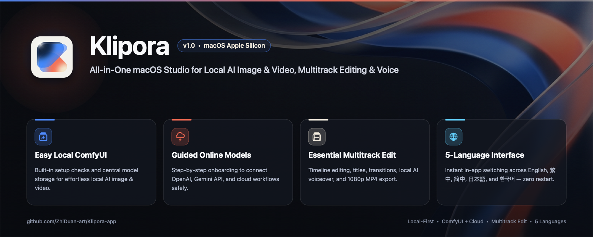
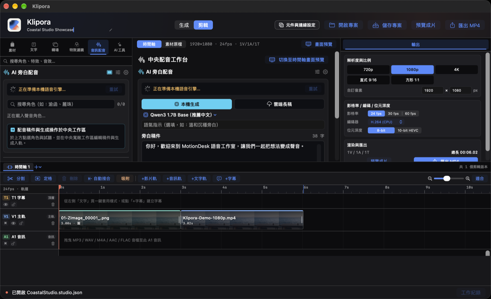
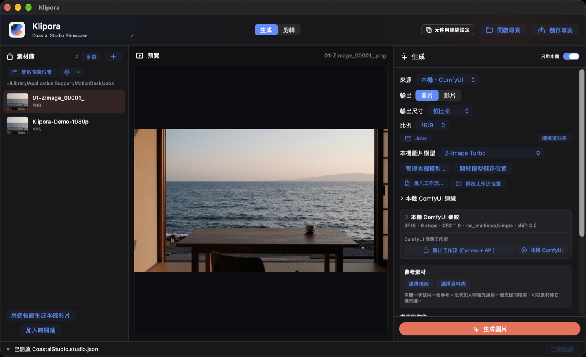
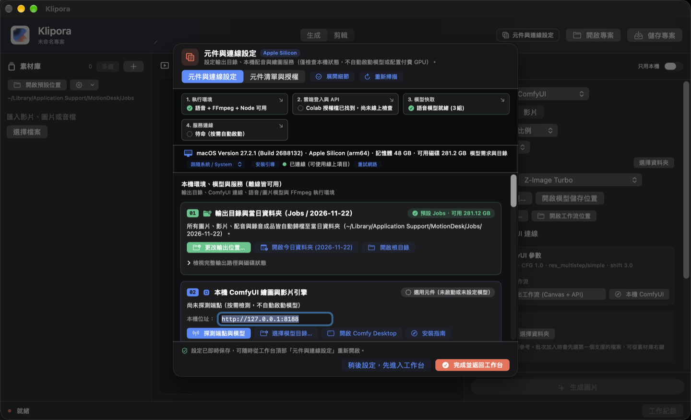

<div align="center">



# Klipora

**All-in-One Local AI Image, Voice & Multitrack Video Studio for Apple Silicon**

*Clip (`Klip`) × Luminous Spatial Aura (`-ora`) — Create, Voice, Cut & Export Offline on macOS.*

**English** · [繁體中文](docs/README.zh-Hant.md) · [简体中文](docs/README.zh-Hans.md) · [日本語](docs/README.ja.md) · [한국어](docs/README.ko.md)

[](#hardware-requirements)
[](#5-language-localization)
[](https://github.com/ZhiDuan-art/Klipora-app/releases)
[](https://portaly.cc/chihtuan)
[](CHANGELOG.md)

</div>

---

> **Latest Update — `v1.1.2` (2026-11-25 02:14 UTC+8):** Added **MediaTek `BreezyVoice`** (Taiwanese Mandarin zero-shot TTS sharing all 68 voice profiles with 1-click install), completed **unified Capsule UI & continuous rounded cards across Edit Mode**, and switched the header project title to **click-to-edit** so Edit Mode keyboard focus never gets stuck. See **[Changelog & Debug Log](CHANGELOG.md)** · **[Download v1.1.2 DMG](https://github.com/ZhiDuan-art/Klipora-app/releases/tag/v1.1.2)**.

## Product Demo Video

*Recorded from live `v1.1.1` macOS app — voiced with offline Qwen3-TTS, unified Capsule UI, Breeze-ASR-26 & 6-tab Settings:*
**[▶ Watch / Download v1.1.1 English 1080p Demo](https://github.com/ZhiDuan-art/Klipora-app/releases/download/v1.1.1/Klipora-Promo-en-1080p.mp4)** · **[▶ Watch / Download v1.1.1 繁體中文配音版 1080p](https://github.com/ZhiDuan-art/Klipora-app/releases/download/v1.1.1/Klipora-Promo-zh-Hant-1080p.mp4)**

https://github.com/user-attachments/assets/cf44c254-edec-46e1-83d6-0114225d340c

<details>
<summary>▶ Watch Traditional Chinese Voiceover Version (繁體中文配音版 · 60s)</summary>

https://github.com/user-attachments/assets/8410f8b6-4835-4497-a124-40e8544bfab2

</details>

---

## Interface Showcase

| Local Neural Voice Studio | AI Image Generation Workspace |
| :---: | :---: |
|  |  |

| Multitrack Video Editor | Setup, Languages & Connections |
| :---: | :---: |
|  |  |

---

## Why Klipora?

Most AI creators bounce between 5 disconnected tools: one web tab for generating images, another script for LoRAs, a terminal for local TTS voiceovers, a browser for cloud video, and a heavy NLE just to cut and add subtitles.

**Klipora unifies the entire creative pipeline into a single native macOS darkroom workstation:**

- **Local-First AI Image Generation**: Native ComfyUI bridge with built-in profiles (`SDXL 1.0`, `Z-Image Turbo`, `RedCraft`, `Iniverse FLUX`, `MOSS`, `Krea-2`), custom `.safetensors` model manager, central deduplicated storage, compatible LoRA manager, and custom ComfyUI API workflow support.
- **Multitrack Pro Video Editor**: Native SwiftUI + CoreText + FFmpeg + HyperFrames timeline with video/audio/subtitle/title tracks, transitions, color filters, and MP4 export.
- **Local Neural Voice Studio**: Bundled MLX / Qwen3-TTS voice synthesis with custom voice profiles, reference voice cloning, and offline AI audio tools.
- **Optional Cloud & Official APIs**: Seamless Google Colab OAuth bridge for Wan 2.2 / H3 cloud video & audio, plus opt-in OpenAI (`gpt-image-2.5-flare`) and Gemini (`gemini-nano-banana-2.1`) image APIs with Keychain-only credential storage and strict offline fallback.
- **Startup Self-Check & 4-Step Onboarding**: Adobe-style launch self-check verifies every engine before you start; first-run wizard checks hardware, guides ComfyUI setup, lets you pick starter models with clear disk-space budgets, and configures optional accounts.

---

## 5-Language Localization

Switch languages anytime inside **Setup & Connections** or the **Onboarding Wizard** — no restart required:

- [繁體中文](docs/README.zh-Hant.md) (`zh-Hant`)
- [简体中文](docs/README.zh-Hans.md) (`zh-Hans`)
- **English** (`en`)
- [日本語](docs/README.ja.md) (`ja`)
- [한국어](docs/README.ko.md) (`ko`)

---

## Hardware Requirements

| Tier | Mac Hardware | Unified Memory | Free Disk | Recommended Workflow |
| :--- | :--- | :--- | :--- | :--- |
| **Standard** | Apple Silicon (M1/M2/M3/M4/M5) | 16 GB | 25 GB+ | SDXL 1.0 Base + Qwen3-TTS 0.6B/1.7B + Multitrack Edit |
| **Pro / Flagship** | Apple Silicon Pro / Max / Ultra | 24–64 GB+ | 80 GB+ | Z-Image Turbo / FLUX / Krea-2 / MOSS + Multiple LoRAs |
| **Cloud Hybrid** | Any Apple Silicon Mac | 16 GB | 10 GB+ | Local Editing + Google Colab / Official Web or Opt-in APIs |

---

## Installation

### Option 1 — Download `.dmg` (Recommended)
1. Download **`Klipora-1.1.2-arm64.dmg`** from [GitHub Releases](https://github.com/ZhiDuan-art/Klipora-app/releases).
2. Drag **Klipora.app** into **Applications**.
3. On first launch (developer/beta ad-hoc signed build), right-click **Klipora.app** → **Open** → **Open**.
4. Follow the built-in 4-step Onboarding Wizard to check hardware, connect ComfyUI, and select starter models.

### Option 2 — Deploy Automatically with Your AI Coding Agent (Codex / Claude / Antigravity)
Give your AI coding agent `https://github.com/ZhiDuan-art/Klipora-app` and ask it to follow **[DEPLOY_WITH_AI.md](DEPLOY_WITH_AI.md)**.

### Option 3 — Build from Source
```bash
git clone https://github.com/ZhiDuan-art/Klipora-app.git
cd Klipora-app/work/studio
bash build-app.sh /tmp/Klipora.app
```

---

## Support Klipora

If Klipora saves you time or helps your creative workflow, consider supporting its ongoing development:

[-EA4AAA?style=for-the-badge)](https://portaly.cc/chihtuan)

- **Ongoing Maintenance:** Keeping ComfyUI workflows, new local image/video/TTS models, and 5-language updates running smoothly on Apple Silicon.
- **Future Aspiration (No Guarantee):** If sponsorship grows enough over time, we hope to eventually consider Apple Developer Program notarization to reduce macOS Gatekeeper prompts, though this is not guaranteed.

---

## Licenses & Third-Party Notices

Copyright © 2026 **Chih Tuan Chang** ([meteor199311@gmail.com](mailto:meteor199311@gmail.com)). All rights reserved.

See `work/studio/resources/THIRD_PARTY_NOTICES.md` and `work/studio/resources/LICENSE-Voicebox`. Large AI model weights are never bundled in this repository and remain subject to their respective upstream model licenses.
