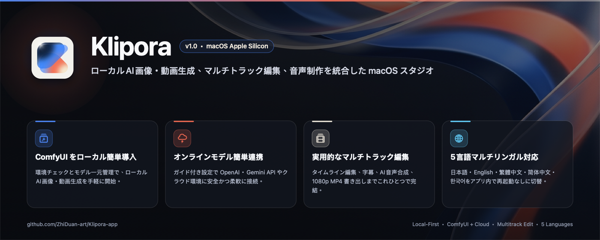
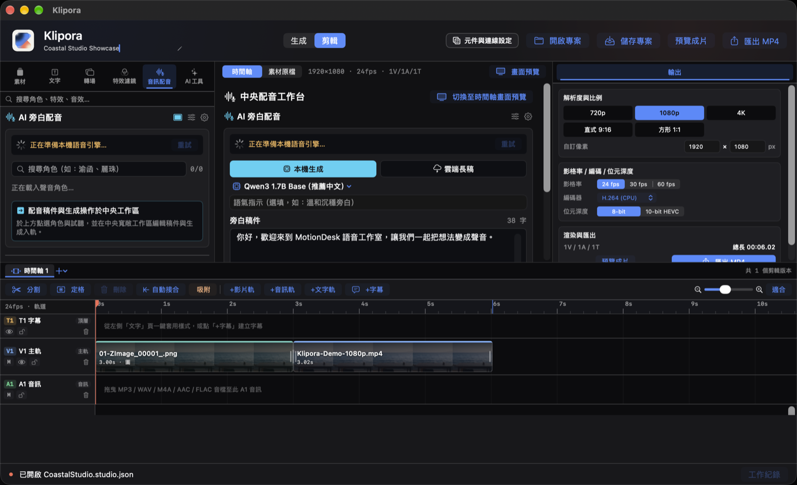
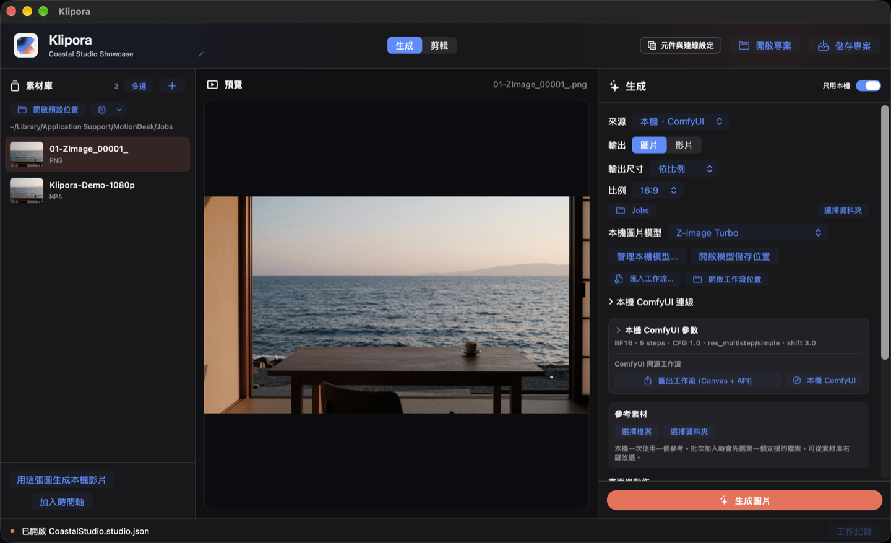

# Klipora

**Apple Silicon 向けローカル AI 画像生成・音声合成・マルチトラック動画編集スタジオ**

*Clip（`Klip`）× 光のオーラと空間感（`-ora`）— macOS でオフライン完結するクリエイティブ環境。*

[English](../README.md) · [繁體中文](README.zh-Hant.md) · [简体中文](README.zh-Hans.md) · **日本語** · [한국어](README.ko.md)

---

> **最新リリース — `v1.1.7`（2026-11-27）**：テキスト記述だけで新しい声質を設計し 68 ボイス庫へ保存できる **`Qwen3-TTS 1.7B VoiceDesign`（MLX 8-bit）** を追加。さらに**4ステップ・バックグラウンド初期セットアップ**を刷新し、タイムライン音声の途切れ解消・プレビュー/書き出し座標一致、**Colab A100 + `10Eros-Max 8-step` + 60 秒自動延長 + ウォーム GPU 保持**、**9 種類の定番比率 + `1K–8K` ローカル画像生成**を統合しました。詳細は **[CHANGELOG.md](../CHANGELOG.md)** · **[v1.1.7 DMG をダウンロード](https://github.com/ZhiDuan-art/Klipora-app/releases/tag/v1.1.7)**。

## 実機デモ動画（`v1.1.7`）

*最新 `v1.1.7` 公式プロモ — HyperFrames 60fps モーショングラフィックス・Colab `10Eros-Max` 映像・実機 UI・ローカル Qwen3-TTS ナレーション＆BGM：*
**[▶ v1.1.7 英語版 1080p 原本をダウンロード](https://github.com/ZhiDuan-art/Klipora-app/releases/download/v1.1.7/Klipora-Promo-v1.1.7-en-1080p.mp4)** · **[▶ v1.1.7 繁體中文版 1080p](https://github.com/ZhiDuan-art/Klipora-app/releases/download/v1.1.7/Klipora-Promo-v1.1.7-zh-Hant-1080p.mp4)**

https://github.com/user-attachments/assets/67ff38e8-a3af-4985-bf47-763fb12a525d

▶ 繁體中文ナレーション＆字幕版を見る（52s）

https://github.com/user-attachments/assets/8c813d60-5f37-40c1-8d83-74ba389a6cad

---

## インターフェース紹介（`v1.1.7` 実機スクリーンショット）

| ローカル音声スタジオ（VoiceDesign × BreezyVoice 68 声質） | AI 画像・動画生成ワークスペース（9 比率・1K–8K） |
| :---: | :---: |
|  |  |

| マルチトラック動画編集（途切れゼロ音声・10-bit HEVC） | 環境設定・4 ステップ導入・5 言語切替 |
| :---: | :---: |
|  |  |

---

## 主な特徴

- **ローカル音声スタジオ（`VoiceDesign` + `BreezyVoice` + `Qwen3-TTS`）**：**`Qwen3-TTS 1.7B VoiceDesign`**（MLX 8-bit）で参照音声なしにテキストから声質をデザインし、ワンクリックで 68 ボイス庫へ保存。**`MediaTek BreezyVoice`**、**`Qwen3-TTS 1.7B Base`**、**`Chatterbox Turbo`**、オフライン **`Breeze-ASR-26`** 自動字幕・ボーカル分離を統合。
- **ローカル完結の AI 画像・動画生成**：ComfyUI ネイティブ連携（`Z-Image Turbo`・`RedCraft 1.5 AIO`・`MOSS-Image BF16`・`Krea-2 Turbo BF16`・`Wan 2.2 14B MoE 4-step`・`LTX-Video 13B`）、**9 種類の定番比率＋`1K / 2K / 4K / 8K` 解像度**、常時表示 **Denoise 解説**、カスタム `.safetensors` / LoRA 管理。
- **ネイティブ・マルチトラック動画編集**：**マーキー複数選択**、全トラック一括リップル削除、**クリップ別独立音声再生**、14 種トランジション、10-bit HEVC / H.264 MP4 書き出し。
- **Google Colab A100＆公式 API 連携**：起動時自動再接続、**L4 / G4 / A100**、**`UPD5` / `10Eros-Max 8-step` / `PRISM`**、**60 秒自動延長**、**15 分ウォーム GPU 保持**、`503` リトライ、任意 OpenAI / Gemini API 対応。
- **刷新された 4 ステップ初期セットアップ**：ウィンドウを閉じてもバックグラウンドでエンジン構築・モデルダウンロードが継続。

---

## 5ヶ国語ローカライズ

「環境・接続設定」または「初期セットアップ」から再起動なしで即座に切り替え可能：**繁體中文 / 简体中文 / English / 日本語 / 한국어**。

---

## 推奨動作環境

| 構成 | Mac ハードウェア | ユニファイドメモリ | 空き容量 | 推奨ワークフロー |
| :--- | :--- | :--- | :--- | :--- |
| **標準** | Apple Silicon (M1–M5) | 16 GB | 25 GB 以上 | Z-Image Turbo / RedCraft + VoiceDesign / BreezyVoice + マルチトラック編集 |
| **プロ / 上位** | Apple Silicon Pro / Max / Ultra | 24–64 GB 以上 | 80 GB 以上 | Z-Image / RedCraft / MOSS / Krea-2 + Wan 2.2 14B MoE + 複数 LoRA |
| **クラウド併用** | 任意の Apple Silicon Mac | 16 GB | 10 GB 以上 | ローカル編集 + Google Colab (L4/G4/A100) / 公式 Web・API |

---

## インストール方法

1. [GitHub Releases](https://github.com/ZhiDuan-art/Klipora-app/releases/tag/v1.1.7) から **`Klipora-1.1.7-arm64.dmg`** をダウンロードし、**Klipora.app** を **Applications** へドラッグします。
2. 初回起動時に警告が表示された場合は、**Klipora.app を右クリック → 開く → 開く** で起動してください。
3. Codex や各種 AI エージェントに `https://github.com/ZhiDuan-art/Klipora-app` を渡し、**[DEPLOY_WITH_AI.md](../DEPLOY_WITH_AI.md)** に従って自動セットアップすることも可能です。

---

## 開発を支援する

---

## ライセンス・お問い合わせ

Copyright © 2026 **Chih Tuan Chang**（[meteor199311@gmail.com](mailto:meteor199311@gmail.com)）. All rights reserved.
