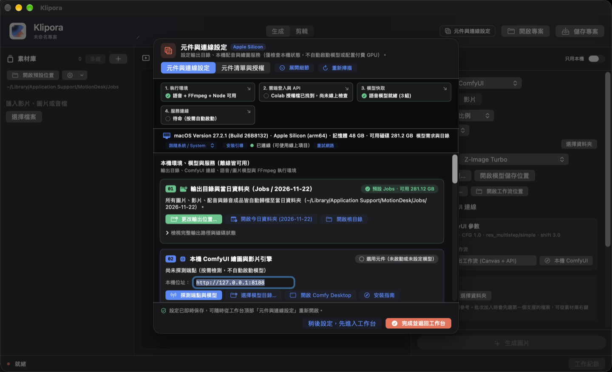

# Klipora

**Apple Silicon 向けローカル AI 画像生成・音声合成・マルチトラック動画編集スタジオ**

*Clip（`Klip`）× 光のオーラと空間感（`-ora`）— macOS でオフライン完結するクリエイティブ環境。*

[English](../README.md) · [繁體中文](README.zh-Hant.md) · [简体中文](README.zh-Hans.md) · **日本語** · [한국어](README.ko.md)

---

## インターフェース紹介

| 起動時セルフチェック | AI 画像生成ワークスペース |
| :---: | :---: |
|  |  |

| マルチトラック動画編集 | 環境・多言語・接続設定 |
| :---: | :---: |
|  |  |

---

## 主な特徴

- **ローカル完結の AI 画像生成**：ComfyUI ネイティブ連携（`SDXL 1.0`、`Z-Image Turbo`、`RedCraft`、`Iniverse FLUX`、`MOSS`、`Krea-2` 対応）、カスタム `.safetensors` モデル管理、重複排除ストレージ、互換 LoRA フィルタ、ComfyUI API ワークフロー対応。
- **ネイティブ・マルチトラック動画編集**：SwiftUI + CoreText 字幕描画 + FFmpeg + HyperFrames により、映像・音声・字幕トラック編集、トランジション、エフェクト、MP4 書き出しを高速処理。
- **ローカル音声スタジオ**：MLX / Qwen3-TTS 音声合成とボイスクローニング、オフライン音声 AI ツールを内蔵。
- **任意クラウド＆公式 API 連携**：Google Colab OAuth（Wan 2.2 / H3）および明示的同意制の OpenAI / Gemini 公式画像 API（API キーは macOS キーチェーンのみに保存）。
- **起動時セルフチェック＆4ステップ初期セットアップ**：起動ごとに主要エンジンを診断。初回はハードウェア診断・ComfyUI 設定・容量表示付きモデル選択ダウンロード・任意ログインを案内。

---

## 5ヶ国語ローカライズ

「環境・接続設定」または「初期セットアップ」から再起動なしで即座に切り替え可能：**繁體中文 / 简体中文 / English / 日本語 / 한국어**。

---

## 推奨動作環境

| 構成 | Mac ハードウェア | ユニファイドメモリ | 空き容量 | 推奨ワークフロー |
| :--- | :--- | :--- | :--- | :--- |
| **標準** | Apple Silicon (M1–M5) | 16 GB | 25 GB 以上 | SDXL 1.0 Base + Qwen3-TTS + マルチトラック編集 |
| **プロ / 上位** | Apple Silicon Pro / Max / Ultra | 24–64 GB 以上 | 80 GB 以上 | Z-Image Turbo / FLUX / Krea-2 / MOSS + 複数 LoRA |
| **クラウド併用** | 任意の Apple Silicon Mac | 16 GB | 10 GB 以上 | ローカル編集 + Google Colab / 公式 Web・API |

---

## インストール方法

1. [GitHub Releases](https://github.com/ZhiDuan-art/Klipora-app/releases) から **`Klipora-1.0.0-arm64.dmg`** をダウンロードし、**Klipora.app** を **Applications** へドラッグします。
2. 初回起動時に警告が表示された場合は、**Klipora.app を右クリック → 開く → 開く** で起動してください。
3. Codex や各種 AI エージェントに `https://github.com/ZhiDuan-art/Klipora-app` を渡し、**[DEPLOY_WITH_AI.md](../DEPLOY_WITH_AI.md)** に従って自動セットアップすることも可能です。

---

## ライセンス・お問い合わせ

Copyright © 2026 **Chih Tuan Chang**（[meteor199311@gmail.com](mailto:meteor199311@gmail.com)）. All rights reserved.
