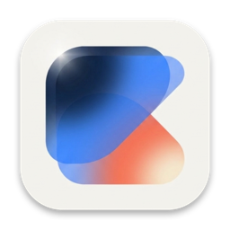

# Klipora

**Apple Silicon용 올인원 로컬 AI 이미지 생성·음성 합성·멀티트랙 영상 편집 스튜디오**

*Clip(`Klip`) × 빛의 아우라와 공간감(`-ora`) — macOS에서 오프라인으로 생성·더빙·편집·내보내기까지 한 번에.*

[English](../README.md) · [繁體中文](README.zh-Hant.md) · [简体中文](README.zh-Hans.md) · [日本語](README.ja.md) · **한국어**

---

## 인터페이스 미리보기

| 로컬 보이스·오디오 스튜디오 | AI 이미지 생성 작업 공간 |
| :---: | :---: |
|  |  |

| 멀티트랙 영상 편집기 | 구성요소·다국어·연결 설정 |
| :---: | :---: |
|  |  |

---

## 주요 기능

- **로컬 우선 AI 이미지 생성**: ComfyUI 네이티브 연동(`SDXL 1.0`, `Z-Image Turbo`, `RedCraft`, `Iniverse FLUX`, `MOSS`, `Krea-2` 기본 프리셋), 사용자 정의 `.safetensors` 모델 관리, 중앙 중복 제거 저장소, 호환 LoRA 필터 및 ComfyUI API 워크플로우 지원.
- **네이티브 멀티트랙 영상 편집**: SwiftUI + CoreText 자막/타이틀 렌더링 + FFmpeg + HyperFrames 기반 비디오·오디오·자막 트랙 편집, 전환, 필터, MP4 내보내기.
- **로컬 뉴럴 보이스 스튜디오**: 내장 MLX / Qwen3-TTS 음성 합성, 보이스 프로필 관리 및 오프라인 AI 오디오 도구.
- **선택적 클라우드 및 공식 API**: Google Colab OAuth(Wan 2.2 / H3) 및 명시적 동의 기반 OpenAI / Gemini 공식 이미지 API(API 키는 macOS 키체인에만 안전 보관).
- **시작 자체 점검 및 4단계 초기 설정**: 앱 실행 시 핵심 엔진 자동 점검, 첫 실행 시 하드웨어 호환성 확인·ComfyUI 연동·용량 표시 모델 선택 다운로드·선택 로그인 안내 제공.

---

## 5개국어 현지화

「구성요소 및 연결 설정」 또는 「초기 설정 가이드」에서 재시작 없이 즉시 전환: **繁體中文 / 简体中文 / English / 日本語 / 한국어**.

---

## 권장 사양

| 등급 | Mac 하드웨어 | 통합 메모리 | 여유 공간 | 권장 워크플로우 |
| :--- | :--- | :--- | :--- | :--- |
| **표준** | Apple Silicon (M1–M5) | 16 GB | 25 GB+ | SDXL 1.0 Base + Qwen3-TTS + 멀티트랙 편집 |
| **프로 / 플래그십** | Apple Silicon Pro / Max / Ultra | 24–64 GB+ | 80 GB+ | Z-Image Turbo / FLUX / Krea-2 / MOSS + 다중 LoRA |
| **클라우드 하이브리드** | 모든 Apple Silicon Mac | 16 GB | 10 GB+ | 로컬 편집 + Google Colab / 공식 웹·API |

---

## 설치 방법

1. [GitHub Releases](https://github.com/ZhiDuan-art/Klipora-app/releases)에서 **`Klipora-1.0.0-arm64.dmg`**를 다운로드하고 **Klipora.app**을 **Applications** 폴더로 드래그합니다.
2. 첫 실행 시 개발자 확인 경고가 표시되면 **Klipora.app 우클릭 → 열기 → 열기**로 실행하세요.
3. Codex 등 AI 코딩 에이전트에 `https://github.com/ZhiDuan-art/Klipora-app`을 전달하고 **[DEPLOY_WITH_AI.md](../DEPLOY_WITH_AI.md)**에 따라 자동 배포할 수도 있습니다.

---

## 저작권 및 문의

Copyright © 2026 **Chih Tuan Chang** ([meteor199311@gmail.com](mailto:meteor199311@gmail.com)). All rights reserved.
