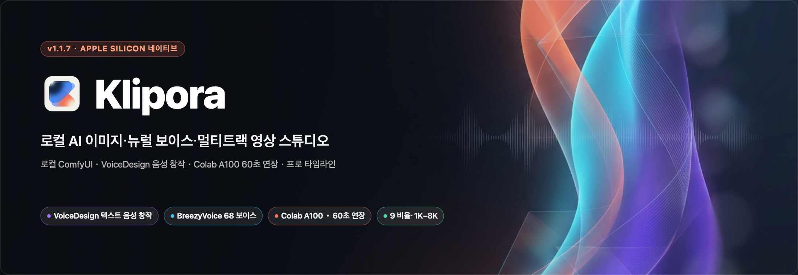
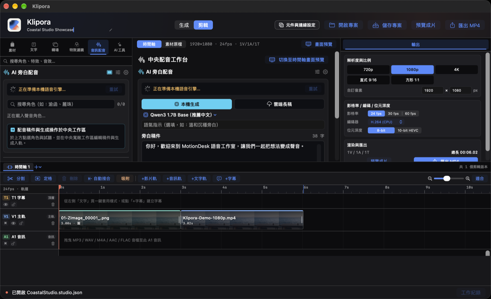
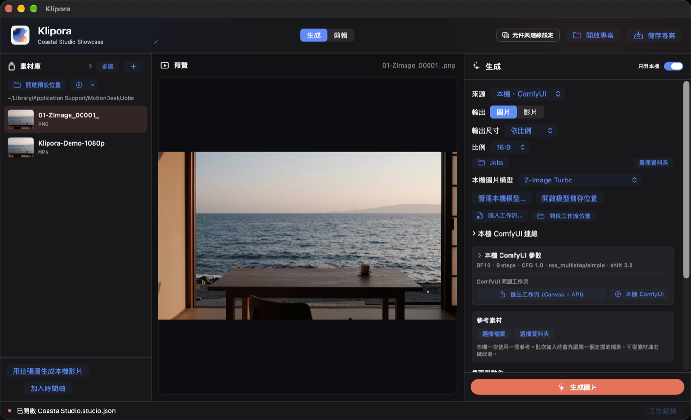
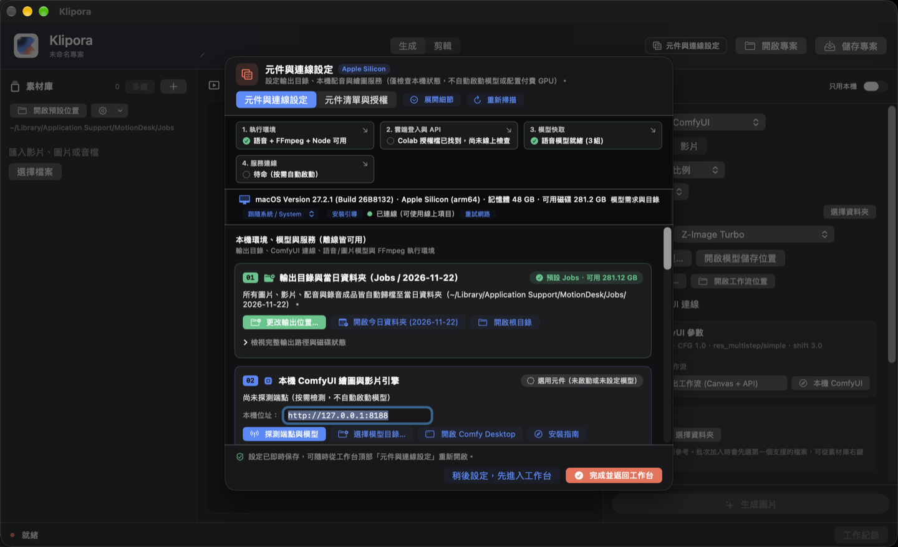

# Klipora

**Apple Silicon용 올인원 로컬 AI 이미지 생성·뉴럴 보이스·멀티트랙 영상 편집 스튜디오**

*Clip(`Klip`) × 빛의 아우라와 공간감(`-ora`) — macOS에서 오프라인으로 생성·더빙·편집·내보내기까지 한 번에.*

[English](../README.md) · [繁體中文](README.zh-Hant.md) · [简体中文](README.zh-Hans.md) · [日本語](README.ja.md) · **한국어**

---

> **최신 릴리스 — `v1.1.7` (2026-11-27)**: 참조 오디오 없이 텍스트 설명만으로 새 음성을 창작해 68 보이스 라이브러리에 저장하는 **`Qwen3-TTS 1.7B VoiceDesign` (MLX 8-bit)** 추가; **4단계 백그라운드 초기 설정 마법사** 전면 개편; 타임라인 오디오 끊김 수정 및 미리보기/내보내기 좌표 일치; **Colab A100 + `10Eros-Max 8-step` + 60초 자동 연속 연장 + 웜 GPU 유지** 및 **9가지 비율 + `1K–8K` 로컬 이미지 생성**을 통합했습니다. **[CHANGELOG.md](../CHANGELOG.md)** · **[v1.1.7 DMG 다운로드](https://github.com/ZhiDuan-art/Klipora-app/releases/tag/v1.1.7)**.

## 실기 데모 영상 (`v1.1.7`)

*공식 `v1.1.7` 프로모 — HyperFrames 60fps 모션 그래픽·Colab `10Eros-Max` AI 영상·실기 UI·로컬 Qwen3-TTS 내레이션 & 사운드트랙:*
**[▶ v1.1.7 영문판 1080p 원본 다운로드](https://github.com/ZhiDuan-art/Klipora-app/releases/download/v1.1.7/Klipora-Promo-v1.1.7-en-1080p.mp4)** · **[▶ v1.1.7 번체중문판 1080p](https://github.com/ZhiDuan-art/Klipora-app/releases/download/v1.1.7/Klipora-Promo-v1.1.7-zh-Hant-1080p.mp4)**

https://github.com/user-attachments/assets/67ff38e8-a3af-4985-bf47-763fb12a525d

▶ 繁體中文 내레이션 및 자막 버전 보기 (52s)

https://github.com/user-attachments/assets/8c813d60-5f37-40c1-8d83-74ba389a6cad

---

## 인터페이스 미리보기 (`v1.1.7` 실기 캡처)

| 로컬 뉴럴 보이스 스튜디오 (VoiceDesign × BreezyVoice 68 보이스) | AI 이미지·영상 생성 작업 공간 (9 비율·1K–8K) |
| :---: | :---: |
|  |  |

| 멀티트랙 영상 편집기 (끊김 없는 독립 오디오·10-bit HEVC) | 구성요소·4단계 설정·5개국어 |
| :---: | :---: |
|  |  |

---

## 주요 기능

- **로컬 뉴럴 보이스 스튜디오 (`VoiceDesign` + `BreezyVoice` + `Qwen3-TTS`)**: **`Qwen3-TTS 1.7B VoiceDesign`** (MLX 8-bit)으로 텍스트 설명만으로 새 음성을 생성하고 원클릭으로 68 보이스 라이브러리에 저장. **`MediaTek BreezyVoice`**, **`Qwen3-TTS 1.7B Base`**, **`Chatterbox Turbo`** 및 오프라인 **`Breeze-ASR-26`** 자동 자막·보컬 분리 지원.
- **로컬 우선 AI 이미지·영상 생성**: ComfyUI 네이티브 연동(`Z-Image Turbo`, `RedCraft 1.5 AIO`, `MOSS-Image BF16`, `Krea-2 Turbo BF16`, `Wan 2.2 14B MoE 4-step`, `LTX-Video 13B`), **9가지 주요 비율 + `1K / 2K / 4K / 8K` 해상도**, 상시 표시 **Denoise 안내**, 사용자 정의 `.safetensors` / LoRA 관리.
- **네이티브 멀티트랙 영상 편집**: **마키 드래그 다중 선택**, 전체 트랙 일괄 리플 삭제, **클립별 독립 오디오 재생**, 14종 전환 효과, 10-bit HEVC / H.264 MP4 내보내기.
- **Google Colab A100 및 공식 API**: 실행 시 자동 재연결, **L4 / G4 / A100**, **`UPD5` / `10Eros-Max 8-step` / `PRISM`**, **60초 자동 연속 연장**, **15분 웜 GPU 유지**, `503` 자동 재시도 및 선택적 OpenAI / Gemini API 지원.
- **개편된 4단계 초기 설정**: 창을 닫아도 백그라운드에서 엔진 설치 및 모델 다운로드가 계속 진행됩니다.

---

## 5개국어 현지화

「구성요소 및 연결 설정」 또는 「초기 설정 가이드」에서 재시작 없이 즉시 전환: **繁體中文 / 简体中文 / English / 日本語 / 한국어**.

---

## 권장 사양

| 등급 | Mac 하드웨어 | 통합 메모리 | 여유 공간 | 권장 워크플로우 |
| :--- | :--- | :--- | :--- | :--- |
| **표준** | Apple Silicon (M1–M5) | 16 GB | 25 GB+ | Z-Image Turbo / RedCraft + VoiceDesign / BreezyVoice + 멀티트랙 편집 |
| **프로 / 플래그십** | Apple Silicon Pro / Max / Ultra | 24–64 GB+ | 80 GB+ | Z-Image / RedCraft / MOSS / Krea-2 + Wan 2.2 14B MoE + 다중 LoRA |
| **클라우드 하이브리드** | 모든 Apple Silicon Mac | 16 GB | 10 GB+ | 로컬 편집 + Google Colab (L4/G4/A100) / 공식 웹·API |

---

## 설치 방법

1. [GitHub Releases](https://github.com/ZhiDuan-art/Klipora-app/releases/tag/v1.1.7)에서 **`Klipora-1.1.7-arm64.dmg`**를 다운로드하고 **Klipora.app**을 **Applications** 폴더로 드래그합니다.
2. 첫 실행 시 개발자 확인 경고가 표시되면 **Klipora.app 우클릭 → 열기 → 열기**로 실행하세요.
3. Codex 등 AI 코딩 에이전트에 `https://github.com/ZhiDuan-art/Klipora-app`을 전달하고 **[DEPLOY_WITH_AI.md](../DEPLOY_WITH_AI.md)**에 따라 자동 배포할 수도 있습니다.

---

## 개발 후원하기

---

## 저작권 및 문의

Copyright © 2026 **Chih Tuan Chang** ([meteor199311@gmail.com](mailto:meteor199311@gmail.com)). All rights reserved.
