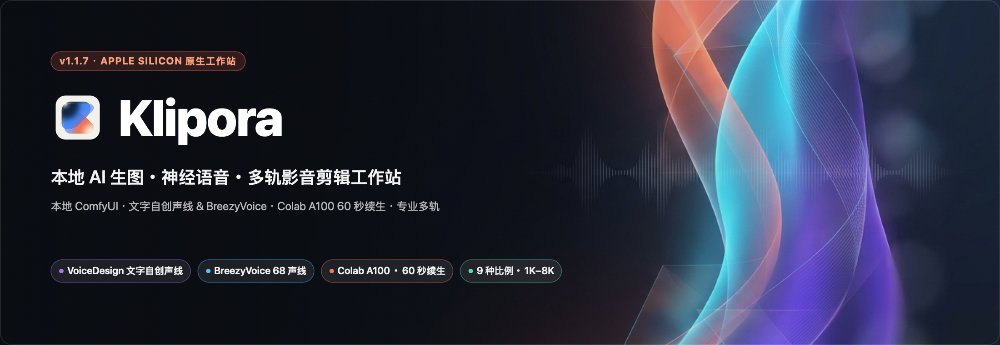
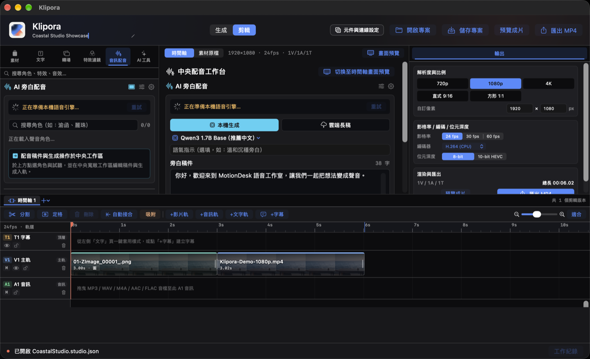
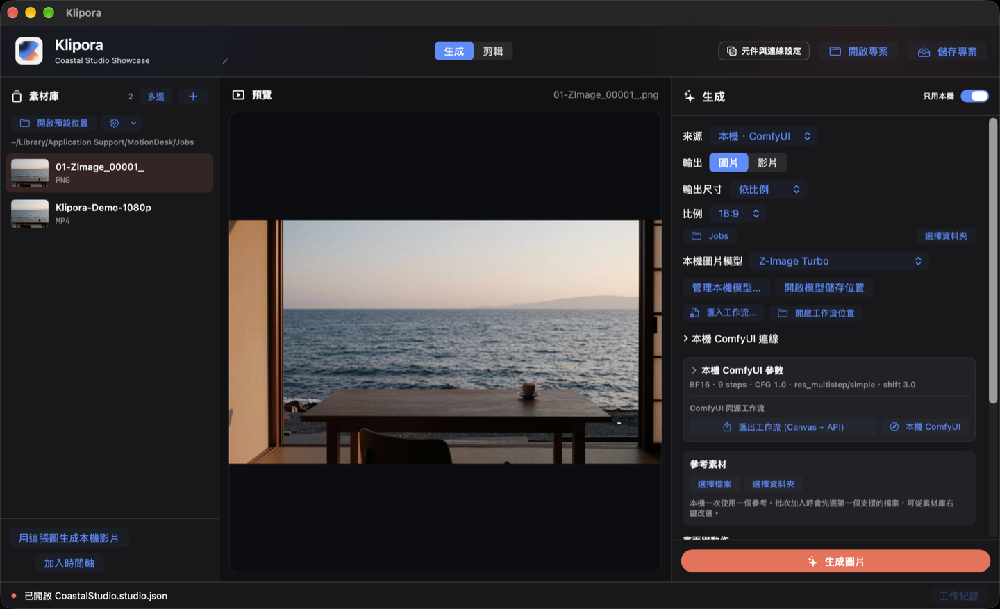
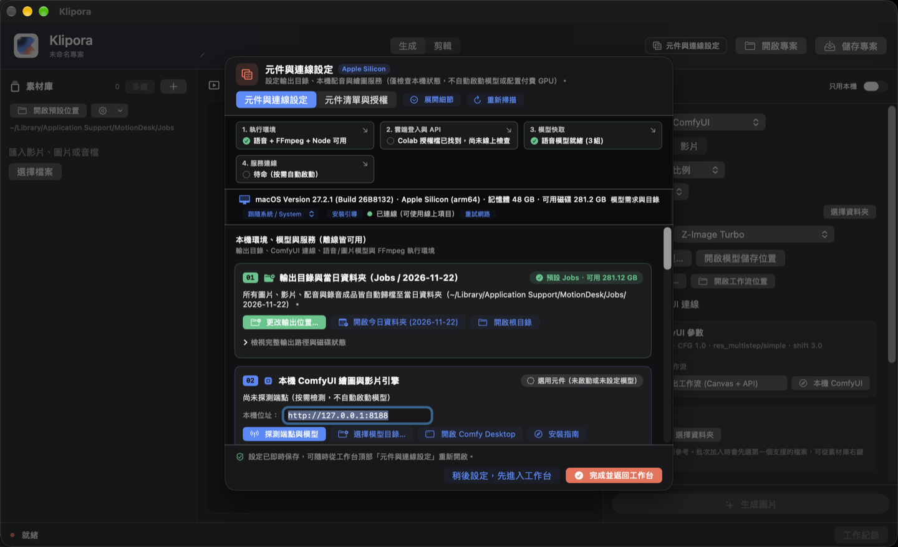

# Klipora

**专为 Apple Silicon 打造的本地 AI 图像生成、神经语音与多轨影音剪辑工作站**

*取自 Clip（`Klip`）× 光晕与空间感（`-ora`）——在 macOS 上离线完成生图、自创声线配音、剪辑与导出。*

[English](../README.md) · [繁體中文](README.zh-Hant.md) · **简体中文** · [日本語](README.ja.md) · [한국어](README.ko.md)

---

> **最新发布 — `v1.1.7`（2026-11-27）**：新增 **`Qwen3-TTS 1.7B VoiceDesign`（MLX 8-bit 文字自创声线）**，免参考音频即可用文字捏出全新角色声音并一键存进 68 声线角色库；重制**四步后台首次安装引导**；修复时间轴音频卡顿与预览／导出坐标一致；全面整合 **Colab A100 + `10Eros-Max 8-step` + 60 秒无缝续生 + 保留热机**，以及 **9 种比例 + `1K–8K` 本地生图**。查看完整 **[更新与除错记录（CHANGELOG.md）](../CHANGELOG.md)** · **[下载 v1.1.7 DMG](https://github.com/ZhiDuan-art/Klipora-app/releases/tag/v1.1.7)**。

## 实机操作宣传视频（`v1.1.7`）

*全新 `v1.1.7` 官方精剪——结合 Klipora 内置 HyperFrames 60fps 动态视觉、Colab `10Eros-Max` 电影感 AI 短片、实机界面、Qwen3-TTS 神经语音旁白与全片配乐音效：*
**[▶ 下载 v1.1.7 中文 1080p 高画质原档](https://github.com/ZhiDuan-art/Klipora-app/releases/download/v1.1.7/Klipora-Promo-v1.1.7-zh-Hant-1080p.mp4)** · **[▶ Download v1.1.7 English 1080p Master](https://github.com/ZhiDuan-art/Klipora-app/releases/download/v1.1.7/Klipora-Promo-v1.1.7-en-1080p.mp4)**

https://github.com/user-attachments/assets/8c813d60-5f37-40c1-8d83-74ba389a6cad

▶ Watch English Voiceover Version (英文配音＋字幕版 · 53s)

https://github.com/user-attachments/assets/67ff38e8-a3af-4985-bf47-763fb12a525d

---

## 界面展示（`v1.1.7` 实机截图）

| 本地神经语音工作室（VoiceDesign × BreezyVoice 68 声线） | AI 图像生成工作区（9 种比例・1K–8K） |
| :---: | :---: |
|  |  |

| 多轨专业剪辑工作区（零卡顿独立音轨・10-bit HEVC） | 设置页、四步快速补装与 5 国语言 |
| :---: | :---: |
|  |  |

---

## 核心特色

- **本地神经语音工作室（`VoiceDesign` + `BreezyVoice` + `Qwen3-TTS`）**：新增 **`Qwen3-TTS 1.7B VoiceDesign`**（MLX 8-bit）免参考音频以文字捏出全新声线并一键存为专属角色，共用 **`MediaTek BreezyVoice`** 68 声线、**`Qwen3-TTS 1.7B Base`**、**`Chatterbox Turbo`** 及离线 **`Breeze-ASR-26`** 自动字幕与人声分离。
- **本地优先 AI 图像与视频生成**：原生集成 ComfyUI（`Z-Image Turbo`、`RedCraft 1.5 AIO`、`MOSS-Image BF16`、`Krea-2 Turbo BF16` 与本地 `Wan 2.2 14B MoE 4-step` / `LTX-Video 13B`），支持 **9 组常见比例＋`1K / 2K / 4K / 8K` 分辨率**、外显 **Denoise 滑块与动态说明**与自定义 `.safetensors` / LoRA 管理。
- **原生多轨音视频剪辑**：支持**鼠标拖拽框选多素材**、跨轨批量波纹删除、**各音频片段独立播放器零卡顿同步**、14 种转场、滤镜与 10-bit HEVC / H.264 MP4 导出。
- **升级版 Google Colab 云端与可选 API**：支持**启动自动连接**、**L4 / G4 / A100** GPU、**`UPD5` / `10Eros-Max 8-step` / `PRISM`**、**60 秒自动分段无缝续接**、**15 分钟保留热机**与 `503` 自动重试，以及可选 OpenAI / Gemini 官方图像 API。
- **重制四步后台首次引导**：引擎建置与模型下载全面后台化，并在设置页顶部常驻快速补装入口。

---

## 5 国语言本地化

可在“组件与连接设置”或“安装引导”中免重启即时切换：**繁體中文**、**简体中文**、**English**、**日本語**、**한국어**。

---

## 硬件需求建议

| 等级 | Mac 硬件 | 统一内存 | 可用磁盘 | 推荐使用方式 |
| :--- | :--- | :--- | :--- | :--- |
| **标准** | Apple Silicon (M1–M5) | 16 GB | 25 GB+ | Z-Image Turbo / RedCraft + VoiceDesign / BreezyVoice + 多轨剪辑 |
| **旗舰** | Apple Silicon Pro / Max / Ultra | 24–64 GB+ | 80 GB+ | Z-Image / RedCraft / MOSS / Krea-2 + Wan 2.2 14B MoE + 多组 LoRA |
| **云端混合** | 任一 Apple Silicon Mac | 16 GB | 10 GB+ | 本地剪辑 + Google Colab (L4/G4/A100) / 官方网页或可选 API |

---

## 安装方式

1. 前往 [GitHub Releases](https://github.com/ZhiDuan-art/Klipora-app/releases/tag/v1.1.7) 下载 **`Klipora-1.1.7-arm64.dmg`**，将 **Klipora.app** 拖入 **Applications**。
2. 首次打开若 macOS 提示无法验证开发者，请右键 **Klipora.app → 打开 → 打开**。
3. 也可直接将仓库链接 `https://github.com/ZhiDuan-art/Klipora-app` 交给你的 Codex／AI 工具，按 **[DEPLOY_WITH_AI.md](../DEPLOY_WITH_AI.md)** 自动部署。

---

## 赞助支持开发

如果 Klipora 对你的创作流程有帮助，欢迎请作者喝杯咖啡支持持续开发（支持信用卡与 PayPal）：

---

## 版权与联系

Copyright © 2026 **Chih Tuan Chang**（[meteor199311@gmail.com](mailto:meteor199311@gmail.com)）. All rights reserved.
