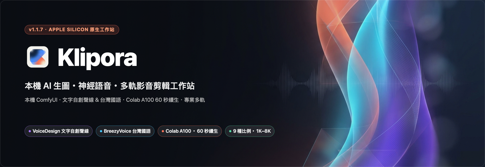
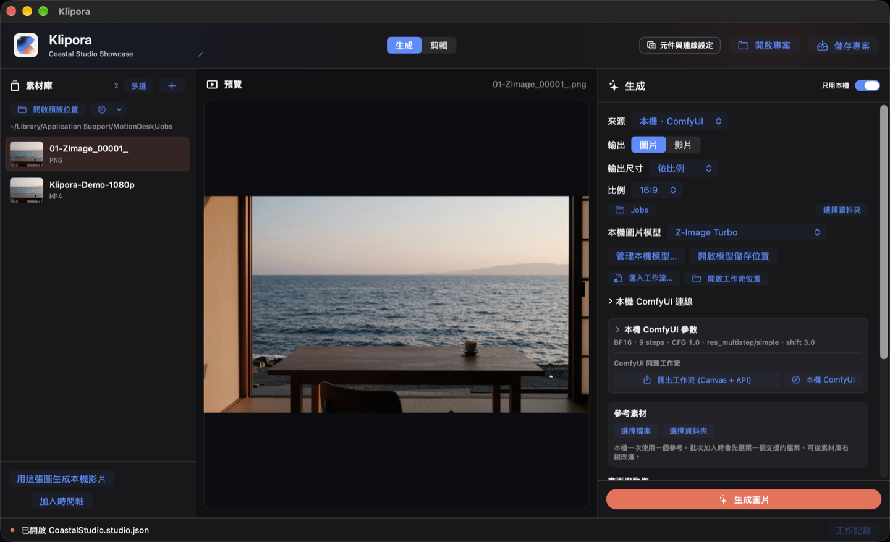
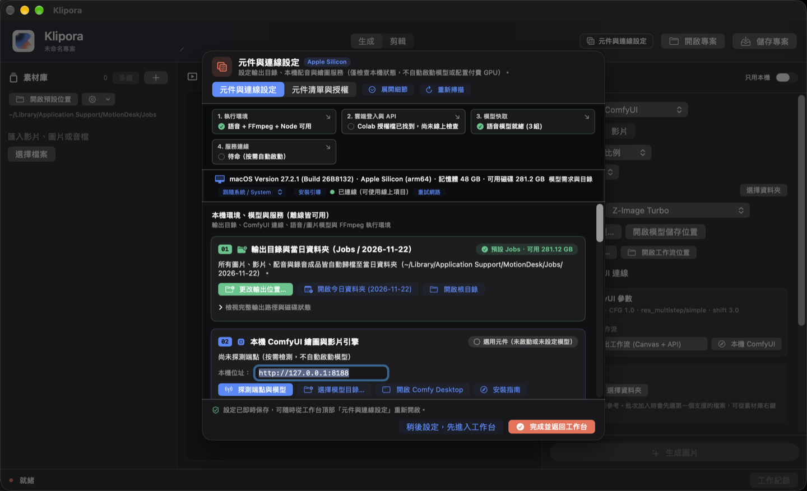

# Klipora

**專為 Apple Silicon 打造的本機 AI 影像生成、神經語音與多軌影音剪輯工作站**

*取自 Clip（`Klip`）× 光暈與空間感（`-ora`）——在 macOS 上離線完成生圖、自創聲線配音、剪輯與匯出。*

[English](../README.md) · **繁體中文** · [简体中文](README.zh-Hans.md) · [日本語](README.ja.md) · [한국어](README.ko.md)

---

> **最新發布 — `v1.1.7`（2026-11-27）**：新增 **`Qwen3-TTS 1.7B VoiceDesign`（MLX 8-bit 文字自創聲線）**，免參考音檔即可用文字捏出全新角色聲音並一鍵存進 68 聲線角色庫；重製**四步驟背景首次安裝引導**；修復時間軸音檔卡頓與預覽／匯出座標一致；全面整合 **Colab A100 + `10Eros-Max 8-step` + 60 秒無縫續生 + 保留熱機**，以及 **9 種比例 + `1K–8K` 本機生圖**。查看完整 **[更新與除錯紀錄（CHANGELOG.md）](../CHANGELOG.md)** · **[下載 v1.1.7 DMG](https://github.com/ZhiDuan-art/Klipora-app/releases/tag/v1.1.7)**。

## 實機操作宣傳影片（`v1.1.7`）

*全新 `v1.1.7` 官方精剪——結合 Klipora 內建 HyperFrames 60fps 動態視覺、Colab `10Eros-Max` 電影感 AI 短片、實機介面、思婕 Qwen3-TTS 神經語音旁白與全片配樂音效：*
**[▶ 下載 v1.1.7 繁體中文 1080p 高畫質原檔](https://github.com/ZhiDuan-art/Klipora-app/releases/download/v1.1.7/Klipora-Promo-v1.1.7-zh-Hant-1080p.mp4)** · **[▶ Download v1.1.7 English 1080p Master](https://github.com/ZhiDuan-art/Klipora-app/releases/download/v1.1.7/Klipora-Promo-v1.1.7-en-1080p.mp4)**

https://github.com/user-attachments/assets/8c813d60-5f37-40c1-8d83-74ba389a6cad

▶ Watch English Voiceover Version (英文配音＋字幕版 · 53s)

https://github.com/user-attachments/assets/67ff38e8-a3af-4985-bf47-763fb12a525d

---

## 介面展示（`v1.1.7` 實機截圖）

| 本機神經語音工作室（VoiceDesign × BreezyVoice 68 聲線） | AI 影像生成工作區（9 種比例・1K–8K） |
| :---: | :---: |
|  |  |

| 多軌專業剪輯工作區（零卡頓獨立音軌・10-bit HEVC） | 設定頁、四步驟快速補裝與 5 國語言 |
| :---: | :---: |
|  |  |

---

## 核心特色

- **本機神經語音工作室（`VoiceDesign` + `BreezyVoice` + `Qwen3-TTS`）**：
  - **`Qwen3-TTS 1.7B VoiceDesign`（Apple Silicon MLX 8-bit）**：免參考音檔，直接用自然語言描述性別、年齡、個性與口音捏出全新聲線，內建 4 組範本並支援一鍵「**存成專屬角色**」加入 68 聲線角色庫。
  - 內建 **`MediaTek BreezyVoice`**（預設台灣國語 · 68 聲線共用）、**`Qwen3-TTS 1.7B Base`**、**`Chatterbox Turbo`**，以及離線 **`Breeze-ASR-26`** 台灣國語自動字幕與人聲分離。
- **本機優先 AI 圖片與影片生成**：原生整合 ComfyUI，內建精選生圖設定檔（`Z-Image Turbo`、`RedCraft 1.5 AIO`、`MOSS-Image BF16`、`Krea-2 Turbo BF16`）與本機 `Wan 2.2 14B MoE 4-step` / `Wan 2.2 5B` / `LTX-Video 13B` 影片（含 Apple Silicon MPS FP8→FP16 Hook），支援 **9 組常見比例＋自適應原圖比例＋`1K / 2K / 4K / 8K` 解析度**、外顯 **Denoise 滑桿與動態說明**、自訂 `.safetensors` / LoRA 管理。
- **原生多軌影音剪輯**：結合 SwiftUI、CoreText 字幕渲染、FFmpeg 與 HyperFrames，支援**滑鼠拖曳框選多素材**、跨軌批次波紋刪除、**各音訊片段獨立播放器零卡頓同步**、14 種轉場、濾鏡與 10-bit HEVC / H.264 MP4 匯出。
- **升級版 Google Colab 雲端與選用 API**：支援**啟動自動連線**、**L4 / G4 / A100** GPU、**`UPD5` / `10Eros-Max 8-step` / `PRISM`** H3 影片模型、**60 秒自動分段無縫續接**（及 3–32 張多影格）、**15 分鐘保留熱機開關**（強化版 Watchdog 關機防呆）與 `503` 自動重試，並可選用 OpenAI / Gemini 官方圖片 API（金鑰僅存於 macOS Keychain）。
- **重製四步驟背景首次引導**：引擎建置與模型下載全面背景化（關閉視窗不中斷），並於「設定 → 一般」頂部常駐快速補裝入口。

---

## 5 國語言在地化

可於「元件與連線設定」或「安裝引導」中免重啟即時切換：**繁體中文**、**简体中文**、**English**、**日本語**、**한국어**。

---

## 硬體需求建議

| 等級 | Mac 硬體 | 統一記憶體 | 可用磁碟 | 建議使用方式 |
| :--- | :--- | :--- | :--- | :--- |
| **標準** | Apple Silicon (M1–M5) | 16 GB | 25 GB+ | Z-Image Turbo / RedCraft + VoiceDesign / BreezyVoice + 多軌剪輯 |
| **旗艦** | Apple Silicon Pro / Max / Ultra | 24–64 GB+ | 80 GB+ | Z-Image / RedCraft / MOSS / Krea-2 + Wan 2.2 14B MoE + 多組 LoRA |
| **雲端混合** | 任一 Apple Silicon Mac | 16 GB | 10 GB+ | 本機剪輯 + Google Colab (L4/G4/A100) / 官方網頁或選用 API |

---

## 安裝方式

### 方式一：直接下載 `.dmg` 安裝檔（推薦）
1. 前往 [GitHub Releases](https://github.com/ZhiDuan-art/Klipora-app/releases/tag/v1.1.7) 下載 **`Klipora-1.1.7-arm64.dmg`**。
2. 將 **Klipora.app** 拖曳至 **Applications** 資料夾。
3. 首次開啟時若 macOS 提示無法驗證開發者（內測簽章版），請對 `Klipora.app` **按右鍵 → 打開 → 打開**。
4. 跟著內建 4 步驟安裝引導即可完成硬體檢測、ComfyUI 連線與模型下載。

### 方式二：交給你的 AI 工具（Codex / Claude / Antigravity）自動部署
直接將本倉庫網址 `https://github.com/ZhiDuan-art/Klipora-app` 交給你的 AI 助手，請它依照 **[DEPLOY_WITH_AI.md](../DEPLOY_WITH_AI.md)** 幫你完成本機部署。

---

## 贊助支持開發

如果 Klipora 對你的創作流程有幫助，歡迎請作者喝杯咖啡支持持續開發（支援信用卡與 PayPal）：

- **持續維護**：跟進最新 ComfyUI 工作流、本機生圖／影片／語音模型相容性與 5 國語言更新。
- **未來期許（不保證）**：若未來贊助累積充足，希望能視情況評估申請 Apple 官方公證（Notarization）以減少 macOS 安全提示，惟此項僅為未來期許，不作保證。

---

## 版權與聯繫

Copyright © 2026 **Chih Tuan Chang**（[meteor199311@gmail.com](mailto:meteor199311@gmail.com)）. All rights reserved.
