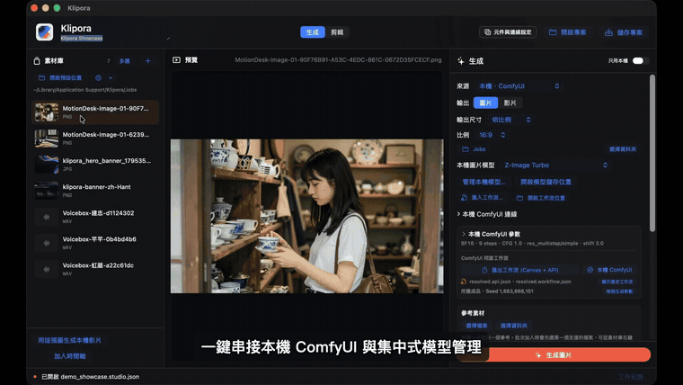
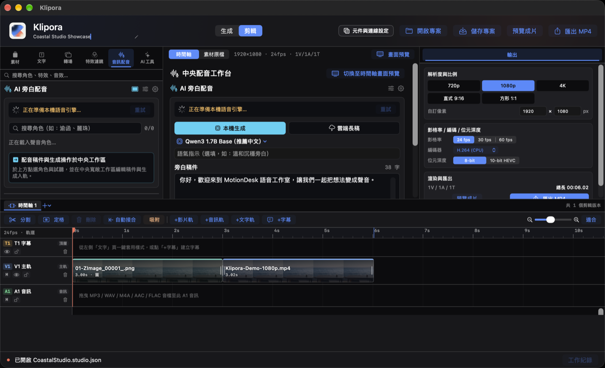

# Klipora

**專為 Apple Silicon 打造的本機 AI 影像生成、語音配音與多軌剪輯工作站**

*取自 Clip（`Klip`）× 光暈與空間感（`-ora`）——在 macOS 上離線完成生圖、配音、剪輯與匯出。*

[English](../README.md) · **繁體中文** · [简体中文](README.zh-Hans.md) · [日本語](README.ja.md) · [한국어](README.ko.md)

---

> **最新更新 — `v1.0.2`（2026-11-23 08:16 UTC+8）**：素材庫新增「滑鼠直接從 Finder 拖入匯入」與「滑鼠框選多選／`⌘+點擊`／批次加入軌道」（生成與剪輯頁皆支援）。查看完整 **[更新與除錯紀錄（CHANGELOG.md）](../CHANGELOG.md)** · **[下載 v1.0.2 DMG](https://github.com/ZhiDuan-art/Klipora-app/releases/tag/v1.0.2)**。

## 實機操作宣傳影片

*純視窗實機錄製——旁白由 Klipora 內建本機 Qwen3-TTS 離線合成，並全程使用 Klipora 多軌時間軸剪輯、上字幕與匯出 1080p。*

  

  <a href="https://github.com/ZhiDuan-art/Klipora-app/releases/download/v1.0.2/Klipora-Promo-zh-Hant-1080p.mp4"><strong>▶ 觀看完整 1080p 實機宣傳片（繁體中文配音，45s）</strong></a>
  &nbsp;·&nbsp;
  <a href="https://github.com/ZhiDuan-art/Klipora-app/releases/download/v1.0.2/Klipora-Promo-en-1080p.mp4"><strong>▶ Watch Full 1080p Demo (English, 44s)</strong></a>

---

## 介面展示

| 本機語音配音工作室 | AI 影像生成工作區 |
| :---: | :---: |
|  |  |

| 多軌專業剪輯工作區 | 元件設定、多國語言與連線 |
| :---: | :---: |
|  |  |

---

## 核心特色

- **本機優先 AI 圖片生成**：原生整合 ComfyUI，內建 `SDXL 1.0`、`Z-Image Turbo`、`RedCraft`、`Iniverse FLUX`、`MOSS`、`Krea-2` 設定檔，支援自訂 `.safetensors` 模型管理、中央去重儲存、相容 LoRA 篩選與自訂 ComfyUI API 工作流。
- **原生多軌影音剪輯**：結合 SwiftUI、CoreText 字幕標題渲染、FFmpeg 與 HyperFrames，支援視訊／音訊／字幕多軌剪輯、轉場、濾鏡與 MP4 匯出。
- **本機神經語音工作室**：內建 MLX / Qwen3-TTS 語音合成、聲音角色庫管理與離線音訊 AI 工具。
- **選用雲端與官方 API**：整合 Google Colab OAuth（Wan 2.2 / H3 雲端影音）及明確授權才啟用的 OpenAI / Gemini 官方圖片 API（金鑰僅存於 macOS Keychain，離線時自動保留本機完整可用）。
- **啟動自檢與 4 步驟首次引導**：每次開啟自動檢查核心引擎與儲存路徑；首次使用提供硬體相容檢測、ComfyUI 安裝與預設路徑寫入、多模型容量標示與勾選下載、以及選用登入引導。

---

## 5 國語言在地化

可於「元件與連線設定」或「安裝引導」中免重啟即時切換：**繁體中文**、**简体中文**、**English**、**日本語**、**한국어**。

---

## 硬體需求建議

| 等級 | Mac 硬體 | 統一記憶體 | 可用磁碟 | 建議使用方式 |
| :--- | :--- | :--- | :--- | :--- |
| **標準** | Apple Silicon (M1–M5) | 16 GB | 25 GB+ | SDXL 1.0 Base + Qwen3-TTS + 多軌剪輯 |
| **旗艦** | Apple Silicon Pro / Max / Ultra | 24–64 GB+ | 80 GB+ | Z-Image Turbo / FLUX / Krea-2 / MOSS + 多組 LoRA |
| **雲端混合** | 任一 Apple Silicon Mac | 16 GB | 10 GB+ | 本機剪輯 + Google Colab / 官方網頁或選用 API |

---

## 安裝方式

### 方式一：直接下載 `.dmg` 安裝檔（推薦）
1. 前往 [GitHub Releases](https://github.com/ZhiDuan-art/Klipora-app/releases) 下載 **`Klipora-1.0.2-arm64.dmg`**。
2. 將 **Klipora.app** 拖曳至 **Applications** 資料夾。
3. 首次開啟時若 macOS 提示無法驗證開發者（內測簽章版），請對 `Klipora.app` **按右鍵 → 打開 → 打開**。
4. 跟著內建 4 步驟安裝引導即可完成硬體檢測、ComfyUI 連線與模型下載。

### 方式二：交給你的 AI 工具（Codex / Claude / Antigravity）自動部署
直接將本倉庫網址 `https://github.com/ZhiDuan-art/Klipora-app` 交給你的 AI 助手，請它依照 **[DEPLOY_WITH_AI.md](../DEPLOY_WITH_AI.md)** 幫你完成本機部署。

---

## 贊助支持開發

如果 Klipora 對你的創作流程有幫助，歡迎請作者喝杯咖啡支持持續開發（支援信用卡與 PayPal）：

- **持續維護**：跟進最新 ComfyUI 工作流、本機生圖／影片／語音模型相容性與 5 國語言更新。
- **未來期許（不保證）**：若未來贊助累積充足，希望能視情況評估申請 Apple 官方公證（Notarization）以減少 macOS 安全提示，惟此項僅為未來期許，不作保證。

---

## 版權與聯繫

Copyright © 2026 **Chih Tuan Chang**（[meteor199311@gmail.com](mailto:meteor199311@gmail.com)）. All rights reserved.
